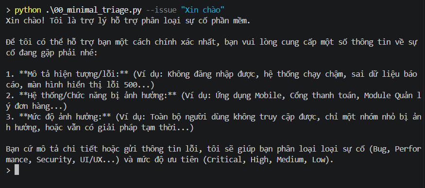
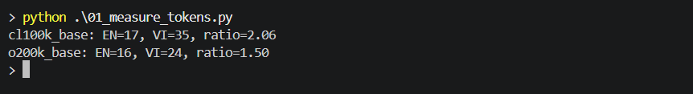
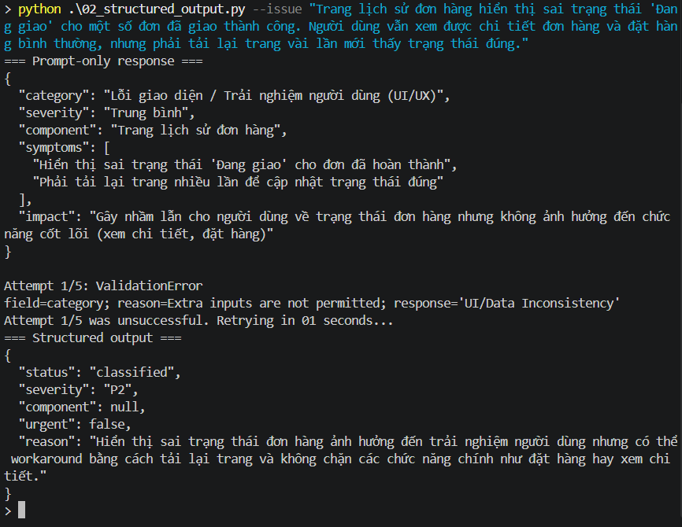
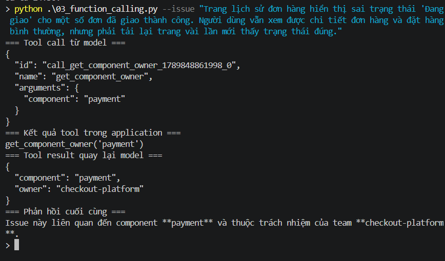
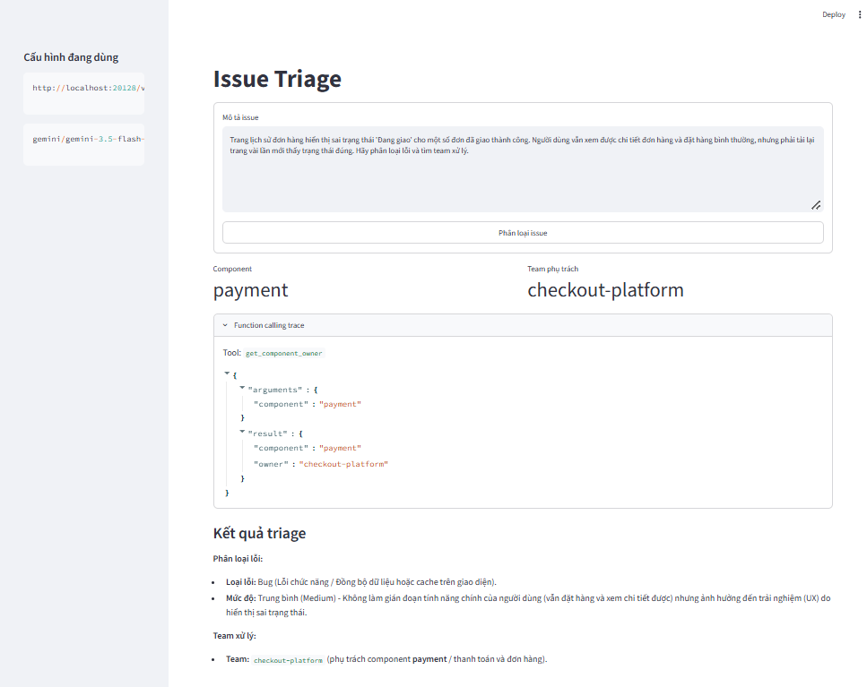

# BÀI TẬP 02 - ISSUE TRIAGE

| Họ và tên | Nguyễn Gia Hưng |
| --- | --- |
| MSSV | 24520604 |

## Link Google Drive chứa source code

[NguyenGiaHung_24520604_IssueTriage](https://drive.google.com/drive/folders/1WusT2vl8FZRnYwR0m3HHzFtGoRWpFW-N?usp=sharing)

File `.env` và API key không được đưa lên Google Drive.

## Nội dung thực hiện

### Demo 00 - LLM call tối thiểu

Demo gửi một mô tả issue đến model và nhận câu trả lời dạng văn bản tự do. Mục tiêu là kiểm tra endpoint, API key và model đã cấu hình có thể gọi được.

### Demo 01 - Đo token tiếng Anh và tiếng Việt

Demo sử dụng thư viện `tiktoken` để đếm và so sánh số token tiếng Anh, tiếng Việt theo hai tokenizer `cl100k_base` và `o200k_base`. Demo này chạy offline, không gọi API.

### Demo 02 - Structured output

Demo so sánh JSON chỉ được yêu cầu bằng prompt với structured output theo schema Pydantic `IssueResult`. Schema kiểm tra các trường `status`, `severity`, `component`, `urgent` và `reason`; dữ liệu sai định dạng được phát hiện bởi validation.

### Demo 03 - Function calling

Model đề xuất gọi tool `get_component_owner` với component phù hợp. Application kiểm tra tool name và arguments, chỉ chấp nhận `payment`, `identity` hoặc `search`, sau đó tra team phụ trách và gửi tool result trở lại model.

Với issue thanh toán Visa trả HTTP 500, model chọn `payment`; application tra được team `checkout-platform`.

### Demo 04 - Giao diện Streamlit

Demo xây dựng giao diện Streamlit cho Issue Triage. Người dùng nhập mô tả issue, bấm nút phân loại và giao diện hiển thị component, team phụ trách, function-calling trace và phản hồi cuối cùng.

